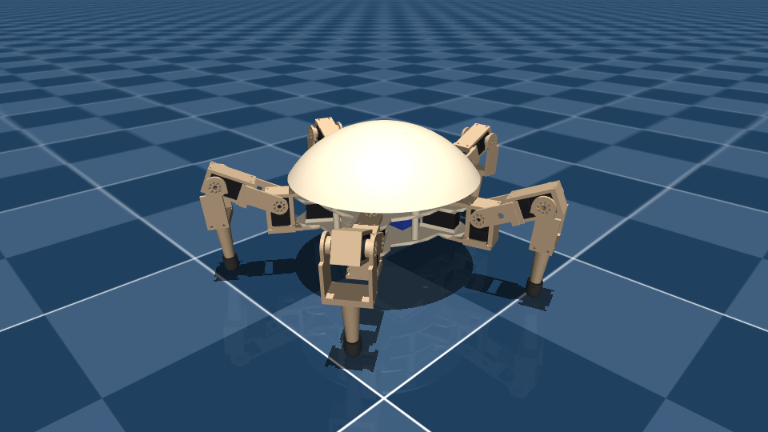
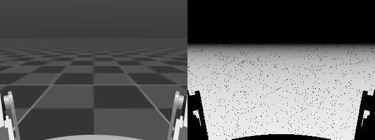
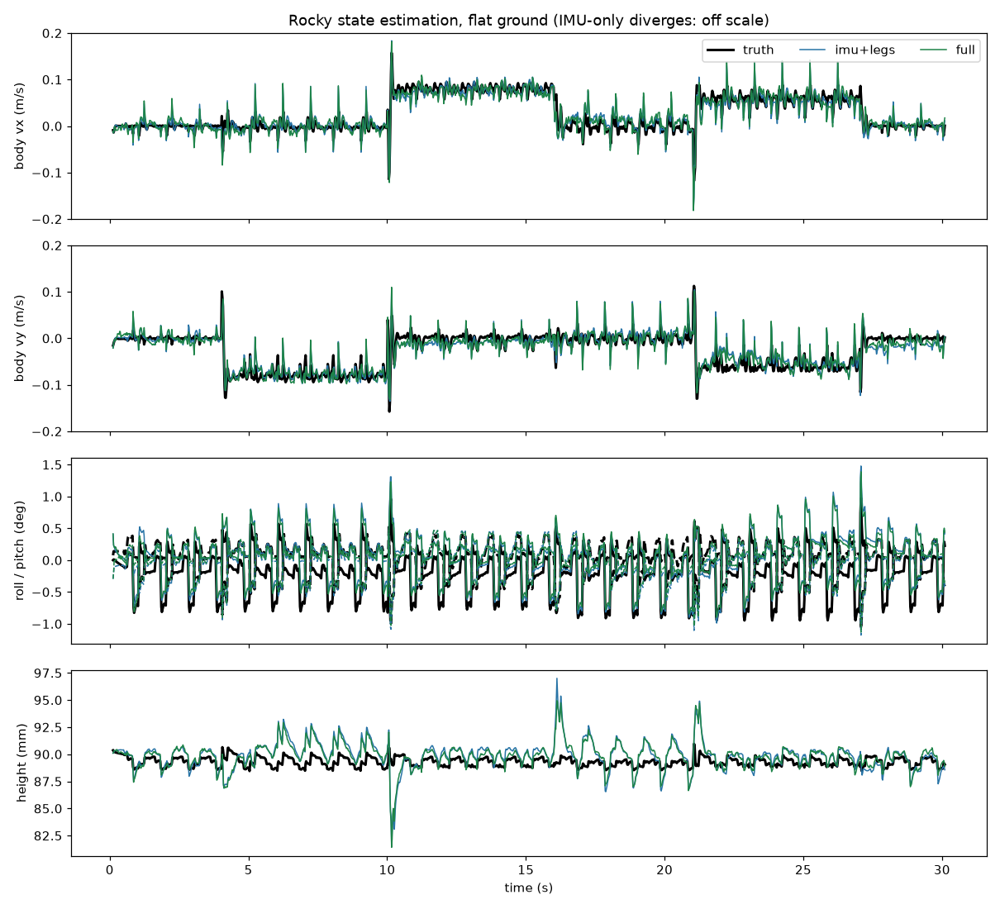

# Rocky pentapod: MuJoCo simulation

This is a MuJoCo model of Rocky (5 legs × 3 HX-30HM servos) built from the v5 Fusion model. It comes with:

- a classical IK gait,
- a Gymnasium RL environment with domain randomisation,
- CPU PPO training (Stable-Baselines3, works on Windows),
- a GPU path (MJX + Brax / MuJoCo Playground) for Linux or WSL2.



| File | What it is |
|---|---|
| `rocky.xml` | Robot MJCF. **Generated** by `build_model.py`; edit the script, not the XML. |
| `scene.xml` / `scene_rough.xml` | Floor, light and sky. The rough scene has a heightfield with bumps up to 2.5 cm and a flat start pad. |
| `meshes/` | Link-frame STLs in metres, exported read-only from Fusion, plus `massprops.json` (the mass model). |
| `build_model.py` | Mass model and servo parameters. Writes `rocky.xml` and `scene_rough.xml`. `--fusion-export DIR` re-processes raw Fusion STLs. |
| `rocky_kinematics.py` | Per-leg FK/IK, joint limits and the stand pose. Matches the MJCF to 1e-7 m. |
| `view.py` | Interactive viewer with servo sliders and keyframes. |
| `gait_demo.py` | Open-loop wave or ripple gait from leg IK at 50 Hz. This is the classical-control starting point. |
| `rocky_env.py` | Gymnasium env `Rocky-v0` (velocity-command tracking). |
| `train_ppo.py` / `play_policy.py` | SB3 PPO on the CPU, then view or evaluate a policy. |
| `rocky_mjx_env.py` / `train_mjx.py` | MuJoCo Playground-style JAX env and Brax PPO for the GPU. |
| `rocky_estimator.py` | **Robot side.** Error-state Kalman filter: IMU + servo encoders (leg odometry) + depth camera. numpy only. |
| `rocky_vision.py` | **Robot side.** Depth-camera measurements: ground-plane fit and RGB-D visual odometry (numpy + OpenCV). |
| `rocky_sensors.py` | Sim only: OAK-D Lite depth render with stereo noise, BNO085 noise and bias. |
| `estimate_demo.py` | Estimator benchmark against ground truth: IMU only vs IMU + legs vs IMU + legs + camera. |
| `verify_model.py` | Model sanity checks: mass, limits, FK, 10 s stand, drop and thrash test. |
| `make_media.py` | Renders `media/` offscreen. |

## Install (Windows, CPU)

```powershell
cd C:\Users\smart\Documents\Pentapod\sim\rocky_mujoco
py -3.12 -m venv .venv            # Python 3.10-3.13 all work
.venv\Scripts\activate
pip install -r requirements.txt   # mujoco, gymnasium, stable-baselines3 (+ CPU torch), imageio
python verify_model.py            # should end with ALL PASS
```

- **Verified on Windows 11 (2026-10-20)**: Python 3.12.10, MuJoCo 3.16.0, torch 2.14.1+cpu, SB3 2.9.0. `verify_model.py` ALL PASS; 300 k-step PPO run in 1.7 min (8 envs, ~3 k steps/s); offscreen camera rendering works.

## View

```powershell
python view.py            # starts standing; right panel "Control" = one slider per servo (s01..s15)
python view.py --hang     # gravity off, body lifted: pose the legs with the sliders
python view.py --rough
```

- To load a keyframe, open the left panel, go to Simulation > Key, pick `stand` or `zero`, then click Load key.
- Rendering > Group enable toggles what is shown: 1 = dome, 2 = parts, 3 = collision shapes, 4 = sites (IMU, feet).

## Classical gait

```powershell
python gait_demo.py                          # wave gait (1 leg in the air), 6 cm/s toward leg 1 (+y)
python gait_demo.py --gait ripple --vy 0.12  # 2 non-adjacent legs swing together
python gait_demo.py --vx 0.08 --vy 0         # sideways relative to leg 1
python gait_demo.py --vy 0 --wz 0.4          # turn on the spot
python gait_demo.py --headless --seconds 12  # prints the measured speed and tilt
```

`WaveGait.feet(t, cmd)` → `rocky_kinematics.ik_all()` → 15 targets is the same loop you would run on the Pi or ESP32. The swing order is 1 → 4 → 2 → 5 → 3, so two neighbouring legs are never in the air at the same time. Nothing reads the IMU yet; body levelling is a good first closed-loop project.

## RL training (CPU)

```powershell
python train_ppo.py --steps 300000 --n-envs 4          # sanity run (~8 min on 2 cores)
python train_ppo.py                                    # default 10 M steps; leave it overnight
python train_ppo.py --residual gait --name ppo_gait    # learn corrections on top of the wave gait
python play_policy.py runs\ppo_rocky\latest.zip        # watch it; --cmd 0 0.08 0 to steer
python play_policy.py runs\ppo_rocky\latest.zip --eval # headless score on 6 fixed commands
python play_policy.py zero --eval                      # baseline: just stand (or --residual gait: just the gait)
```

- Training writes checkpoints, `latest.zip`, `vecnormalize.pkl` and `progress.csv` to `runs/<name>/`. The CSV includes every reward term as `terms/*`.
- If you `pip install tensorboard`, you can watch training with `tensorboard --logdir runs`.
- From-scratch locomotion (`--residual stand`) usually needs tens of millions of steps. On a CPU that is overnight; on a GPU (below) it takes minutes.
- `--residual gait` starts out already walking, so you can see results with far less compute.

### Environment interface (mirrors the real robot)

- **Control:** 50 Hz (`control_dt = 0.02`), with 10 physics steps of 2 ms each.
- **Action** (15 values, range ±1): `target = q_ref + 0.35 rad × action`, clipped to the joint limits.
  - `q_ref` is the stand pose, or the open-loop gait with `--residual gait`.
  - Action index *i* is servo ID *i*+1.
- **Observation** (54 values; 56 in gait mode, which adds the gait phase as sin/cos):

  | Index | Content |
  |---|---|
  | 0–2 | gyro (rad/s) |
  | 3–5 | gravity direction in the body frame (from the IMU quaternion) |
  | 6–20 | joint position − stand pose (quantised to the 12-bit encoder, plus calibration offset) |
  | 21–35 | joint velocity (finite difference of the reported positions) |
  | 36–50 | last action |
  | 51–53 | command (vx, vy, wz) |

  Accelerometer, true body velocity and foot contacts are in `info`.
- **Reward:** the `REWARD_SCALES` in `rocky_env.py`, all multiplied by dt:
  - tracking of xy velocity and yaw rate (exponential kernels);
  - penalties on vertical velocity, roll/pitch rate, tilt, body height, torque², joint velocity², action rate, joint-limit proximity, and leg or self collisions;
  - foot air-time reward, an alive bonus, and −50 on a fall.
- **Termination** happens when any of these is true: the dome or chassis touches the ground, tilt exceeds 60°, or the body is below 3 cm. Episodes are truncated at 20 s, and the command is resampled every 10 s.
- **Domain randomisation** (`DEFAULT_DR`):

  | Parameter | Range |
  |---|---|
  | foot/floor friction | ×0.5 to ×1.25 |
  | added base mass | −0.15 to +0.35 kg |
  | CoM shift | ±15 mm |
  | servo kp | ×0.75 to ×1.25 |
  | battery voltage | 9.9 to 12.6 V (scales stall torque and gain) |
  | joint damping | ×0.8 to ×1.2 |
  | gear friction | ×0.5 to ×2 |
  | per-servo zero offset | ±1.5° |
  | actuation latency | 0 to 12 ms |
  | observation noise | on |
  | velocity kicks | ±0.15 m/s every ~4 s |

## Depth camera and state estimation (v7)

The v7 model carries a **Luxonis OAK-D Lite** on the dome apex (CAD: `fusion/pentapod_camera_v7.py`, Fusion
document "Pentapod Walker v7"). It looks along body −y, the gap between legs 3 and 4, pitched 15° down.
USB-C goes straight down through the cap to a Pi 5 USB 3 port.



*Left: the camera's grey image; right: depth (darker = farther, black = no depth). Legs 3 and 4 are in the bottom corners; the visual odometry masks them out.*

| | |
|---|---|
| MuJoCo camera | `oakd`, in body `camera`, at the RGB lens: (0, −38.9, 133.0) mm, fovy 58° (73 × 58° like the OV7251 stereo pair) |
| Mass | 61 g camera + 14.4 g that the mount adds over the v6 apex cap: total **2.582 kg** |
| Depth model (`rocky_sensors.DepthCamera`) | rendered depth → disparity (75 mm baseline, 640 px), 0.15 px noise, 1/8 px sub-pixel steps, 0.2–8 m, holes at depth edges + 2 % dropouts. Error: 0.3 % below 1 m, 1.4 % at 2–4 m, 2.5 % at 4–8 m (datasheet: < 2 % below 3 m). |
| Cost | 160 × 120 depth + grey render and vision ≈ 17 ms per frame on this PC |

### Estimator (`rocky_estimator.py`)

A 15-state error-state Kalman filter (position, velocity, attitude, gyro bias, accel bias):

| Source | Rate | Used for |
|---|---|---|
| BNO085 gyro + accelerometer | 250 Hz | prediction (strapdown, IMU lever arm) |
| 15 servo encoders | 50 Hz | **leg odometry**: stance feet are still on the ground, so `v_body = −(ω × p_foot + ṗ_foot)` (FK of the measured angles), averaged over feet that agree with the median; **stance-foot height** → body height and tilt |
| OAK-D Lite ground plane | 25 Hz | RANSAC plane under the robot → roll, pitch and height above the ground |
| OAK-D Lite visual odometry | 25 Hz | KLT features lifted with depth, RANSAC rigid fit → body velocity and **rotation rate** (makes the gyro bias, and so yaw drift, observable) |

- Camera measurements arrive 40 ms late. The filter compares them with its own state at capture time, kept in a short history.
- Stance detection uses encoders only (low foot and not moving vertically), because HX-30HM load feedback is not confirmed. If the servos report load, pass `femur_load` to `update_legs`.
- χ² gating drops slips and bad VO frames. After 5 rejected leg updates in a row, the gate is skipped, so a push cannot lock the filter out.
- Absolute x, y and yaw are not observable from these sensors. They drift (slowly with the camera); a magnetometer or a map would be needed to fix them.

```powershell
python estimate_demo.py                    # 30 s: stand, sideways, forward, turn, diagonal, stop
python estimate_demo.py --terrain rough
python train_ppo.py --estimator ekf        # policy also sees the estimated body velocity + height
python play_policy.py runs\ppo_rocky\latest.zip --estimator ekf_cam --eval   # same obs, camera in the loop
```

Results: `estimate_demo.py`, wave gait, 30 s of mixed commands, 1.65 m walked, truth speed 0.066 m/s RMS. Sensors: noisy and biased IMU, 12-bit encoders with ±1.5° calibration offsets, camera at 25 Hz with 40 ms latency.

| Terrain | Estimator | v_xy RMSE | v_z RMSE | roll/pitch RMSE | height RMSE | xy drift | yaw drift |
|---|---|---|---|---|---|---|---|
| flat | IMU only | diverges (19.7 m/s) | 2.3 m/s | 8.3° | 8 m | 445 m | 15.6° |
| flat | IMU + legs | 0.021 m/s | 0.019 m/s | 0.29° | 1.4 mm | 0.09 m | 24.5° |
| flat | IMU + legs + camera | 0.021 m/s | 0.018 m/s | 0.26° | 1.3 mm | **0.02 m** | **3.8°** |
| rough | IMU + legs | 0.033 m/s | 0.024 m/s | 0.74° | 4.2 mm | 0.23 m | 43.9° |
| rough | IMU + legs + camera | 0.033 m/s | 0.024 m/s | 0.61° | 4.6 mm | **0.04 m** | **7.4°** |



- The servo encoders do most of the work for velocity, tilt and height. The camera mainly removes drift: about 4–6× less position drift and yaw drift.
- The remaining velocity error is mostly encoder quantisation (1.5 mrad on a ~0.2 m lever is ~15 mm/s per foot at 50 Hz) and the spikes at touchdown. Reading the servos at a higher rate, or using load feedback for contact, would lower it.
- Inside `RockyEnv(estimator="ekf")` the throughput is ~780 steps/s on one core (2.6 k without the estimator). `ekf_cam` runs at ~120 steps/s, so use it for evaluation, not for training.

### Training with the estimator (Windows CPU sanity runs, 2026-10-20)

| Run | Steps | Time (8 envs) | ep_rew_mean | `play_policy --eval` | Zero-action baseline |
|---|---|---|---|---|---|
| `train_ppo.py --n-envs 8` (IMU obs, as before) | 300 k | 1.7 min, ~3.0 k steps/s | 19.1 → 19.8 | 23.70 | 24.33 |
| `train_ppo.py --n-envs 8 --estimator ekf` | 300 k | 2.7 min, ~1.85 k steps/s | 17.8 → 20.2 | 24.25 (24.24 with `--estimator ekf_cam`) | 24.33 |

Both runs show that the pipeline works end to end. At 300 k steps, neither policy does more than stand, which matches the earlier sanity runs. A walking policy still needs 10–50 M steps.

## GPU training (WSL2 + NVIDIA GPU)

Set up and run from Windows. The scripts live in this folder; the venv is `~/rocky` inside WSL.

```powershell
wsl -d Ubuntu -- bash /mnt/c/Users/smart/Documents/Pentapod/rocky/sim/rocky_mujoco/wsl_setup.sh      # once, no sudo
wsl -d Ubuntu -- bash /mnt/c/Users/smart/Documents/Pentapod/rocky/sim/rocky_mujoco/wsl_run.sh train_mjx.py --smoke
wsl -d Ubuntu -- bash /mnt/c/Users/smart/Documents/Pentapod/rocky/sim/rocky_mujoco/wsl_run.sh train_mjx.py --num-timesteps 100000000 --est-obs --name mjx_big
```

- `wsl_setup.sh`: uv-provided Python 3.12 (Ubuntu 26.04 ships 3.14), then JAX 0.9.2 + CUDA 12, MuJoCo/MJX 3.16, MuJoCo Warp 3.16, Brax 0.14.2, Playground 0.2.0, and an ffmpeg for the videos. It uses pip, not `uv pip`, because uv rejects some NVIDIA wheels.
- `wsl_run.sh`: turns off JAX's 75 % VRAM preallocation (Windows apps already hold ~8 GB of the 3060's 12 GB), filters XLA's harmless WSL driver-version log spam, and tees output to `runs/wsl_last.log`.
- Outputs go to `runs/<name>/`:
  - `params.pkl` (final) and `params_latest.pkl` (updated at every eval);
  - `progress.csv`, `config.json`;
  - **`videos/step_XXXXXXXk.mp4`**: a 9 s clip with the tracking camera and a fixed command script (forward, sideways, turn). One is recorded before training starts, one after each of the `--num-evals` evals, and one at the end.
- **Live window**: `wsl -d Ubuntu -- bash .../wsl_watch.sh runs/<name>` shows the newest clip looping plus the eval-reward curve and ETA, and updates at every checkpoint. Left/right keys browse older clips; End goes back to the newest. It runs inside WSL (drawn by WSLg) because Windows can run out of RAM during training; `python watch_training.py` works the same on Windows. Add `--record out.mp4` to save one loop of the window.
- `wsl_record_dashboard.sh runs/<name> 100 200` saves those window recordings automatically when the run passes 100 M and 200 M steps, and when it finishes.
- `--est-obs` gives the policy the Kalman-filter body velocity and height (true value + the measured estimator error), the same 4 inputs as `RockyEnv(estimator="ekf")`.
- Measured on the RTX 3060 (2026-10-20), 4096 envs, JAX backend: **~7 k env steps/s** including evals (5.9 M steps in 18 min). 100 M steps is about 4 h.

- `rocky_mjx_env.RockyJoystick` uses the same robot, the same 50 Hz interface, observations and reward as the CPU env.
- Simplifications for speed:
  - only the foot spheres collide with the floor, and falls are detected from tilt and height;
  - there is no encoder quantisation or latency buffer;
  - the physics step is 4 ms.
- The critic gets privileged observations: true body velocity and height.

## Joint, actuator and servo map

The leg angle is measured from body +x, counter-clockwise when seen from above. Leg 1 points along body +y; this is the Fusion model frame.

| Leg | Angle | Hip (yaw) | Femur (pitch) | Knee (pitch) |
|---|---|---|---|---|
| 1 | 90° | ID 1 `s01_leg1_hip` | ID 2 `s02_leg1_femur` | ID 3 `s03_leg1_knee` |
| 2 | 162° | ID 4 `s04_leg2_hip` | ID 5 `s05_leg2_femur` | ID 6 `s06_leg2_knee` |
| 3 | 234° | ID 7 `s07_leg3_hip` | ID 8 `s08_leg3_femur` | ID 9 `s09_leg3_knee` |
| 4 | 306° | ID 10 `s10_leg4_hip` | ID 11 `s11_leg4_femur` | ID 12 `s12_leg4_knee` |
| 5 | 18° | ID 13 `s13_leg5_hip` | ID 14 `s14_leg5_femur` | ID 15 `s15_leg5_knee` |

- Joints are named `leg{n}_hip`, `leg{n}_femur` and `leg{n}_knee`. Actuators are `s{ID}_leg{n}_{joint}`. Sensors are `q_*`, `dq_*` and `tau_*`, plus `imu_quat`, `imu_gyro`, `imu_acc` and `leg{n}_foot_touch`.
- Angles are in radians. q = 0 is the CAD pose: coxa radial, femur horizontal, tibia vertical.
- The sign convention is `+hip` = counter-clockwise from above, `+femur` = up, `+knee` = foot moves inward.
- **On the real robot**, measure each servo's sign and its raw reading at q = 0 once. After that, `raw = zero_raw + sign × q / resolution`.

| Joint | Limit | Source |
|---|---|---|
| hip | ±75° | v5 notes |
| femur | −45° (down) to +85° (up) | Down is from the v5 notes. Up: the notes say "free at yaw 0"; I swept the femur and knee-servo meshes and they hit the dome at about +93° at yaw 0, so the limit is +85° for margin. At large hip yaw the femur meets the dome sooner; the dome's collision hull models this. |
| knee | −60° (out) to +75° (in) | Inward is from the v5 notes. **Outward −60° is my assumption.** |

- The **stand pose** puts each foot centre 220 mm out from the body axis and 81 mm below the plate mid-plane. That gives a body height of 91 mm and 55 mm of ground clearance under the battery tray.
  - Femur +23.9°, knee +28.6°, hip 0°.
  - The femur holds 0.28 N·m while standing (stall torque is 2.94 N·m).

## Assumptions (mass and servo)

| Item | Value | Source / method |
|---|---|---|
| HX-30HM servo | **52 g** each (15 total) | Spec ([openelab / Hiwonder listing](https://openelab.io/products/hx-30hm-bus-servo)). Placed at the STEP model's centroid. |
| Torque | **2.94 N·m** (30 kg·cm @ 11.1 V), used as the stall-torque clip | Same listing. It is quoted as the rated torque; no separate stall figure is published. |
| No-load speed | **5.51 rad/s** (0.19 s/60° @ 11.1 V) | Same listing |
| Encoder | 12-bit (360°/4096 = 0.088°), 0.3° accuracy, 1 Mbaud bus | Same listing. The brief's 0.24° is the LX-series value; change `ENCODER_RES` in `rocky_env.py` if your servos report coarser. |
| Servo model | Voltage-mode P servo: `τ = clip(kp·(target − q), ±τ_stall) − kv·q̇`, with kp = 30 N·m/rad (saturates at 5.6° error) and kv = τ_stall/ω_noload = 0.533 N·m·s/rad | The kv (back-EMF) term is the joint damping, so the torque-speed line τ_max(ω) = τ_stall(1 − ω/ω₀) and the 5.5 rad/s speed limit come out of the physics. **kp is an estimate; fit it from a step response.** |
| Armature | 0.004 kg·m² | Estimated: rotor about 5e-8 kg·m² × gear ratio² (about 285²) |
| Gear friction | 0.03 N·m Coulomb | Estimate |
| Printed parts | CAD volume × 1.24 g/cc (PLA) × **0.80 fill factor** (dome × 0.95) | Volumes from Fusion; the mesh volumes agree to 0.3 %. Coxa 39.9 g, femur 37.1 g, tibia 41.8 g, chassis (plates, standoffs, tray, posts, deck) 397.9 g, dome 203.7 g. |
| Foot | TPU 1.21 g/cc × 0.9 → 5.4 g | |
| Fasteners | 4 g per leg link, 25 g in the base | Estimate |
| Battery | 188 g, 3S 2200 mAh | Typical 25–30C pack, CAD volume |
| Raspberry Pi 5 + Active Cooler | 46 g + 21 g | Box over the CAD bounding box |
| Control PCB (v6) | 65 g, a 75 × 75 × 12 mm box on the top plate (old WAGO hub spot) | Mid-point of 50–80 g; **move it in `build_model.py` once the PCB placement is fixed** |
| Wiring, XT60, fuse | 60 g, spread around the plate | Estimate |
| Magnets, tie rods | 38.3 g | Fusion (steel) |
| OAK-D Lite + camera mount (v7) | 61 g + 14.4 g (mount volume 26.7 cm³ minus the 12.3 cm³ v6 cap, PLA × 0.8) | Datasheet; Fusion volume. Separate body `camera` |
| **Total** | **2.582 kg** (v6: 2.507 kg): base 1.305 kg; camera 75.4 g; per leg: coxa 95.9 g, femur 93.1 g, tibia 51.3 g | |

- Not included: the old v5 electronics (ESP32, BusLinker, Pololu, LM2596, WAGO hub), which v6 removes.
- The IMU site uses the v5 BNO085 location (−48.3, 41.45, 60.5 mm). If the IMU moves to the PCB, move `site name="imu"`.

### Contact

- Feet are 10 mm spheres with friction 1.0 (TPU), `solref 0.006 1`.
- Everything else uses friction 0.6.
- Body collision uses the convex hulls of the chassis and the dome cap. Legs use boxes and capsules. Leg-to-leg self-collision is on.
- Solver settings: `implicitfast`, 2 ms timestep, pyramidal cone.

## Verification (run in the Linux container, MuJoCo 3.16.0)

- `verify_model.py`: **ALL PASS**.
  - Total mass is 2.507 kg, and the joint ranges match the table.
  - FK matches the MuJoCo foot sites to < 1e-7 m over 300 random poses, and IK(FK) round-trips.
  - The model starts with no contacts.
  - It stands for 10 s with 0.00 mm drift and 0.00° tilt; it settles 0.8 mm, with 0.07 mm of foot penetration and only the 5 feet in contact.
  - After a 25 cm drop and 8 s of random 2 Hz targets: no NaNs or warnings, max |q̇| 6 rad/s.
- Gait demo, headless, 12 s, flat ground:

  | Gait | Command | Measured | Max tilt |
  |---|---|---|---|
  | wave | vy 0.06 m/s | 0.0625 m/s | 0.3° |
  | ripple | vy 0.06 m/s | 0.0615 m/s | 0.2° |
  | ripple | vx 0.08 m/s | 0.0822 m/s | 0.3° |
  | ripple, 0.8 s period | vy 0.15 m/s | 0.154 m/s | 0.3° |
  | wave | wz 0.4 rad/s | 0.404 rad/s | 0.4° |
  | wave, rough terrain, 30 s | vy 0.06 m/s | 0.062 m/s | 2.6° |

  It stayed upright in every run.
- `gymnasium.utils.env_checker.check_env` passes in both modes. The env runs at about 1.4 k steps/s on one core with domain randomisation on.
- PPO sanity runs (2 envs, 300 k steps, about 8 min each on a 2-core CPU) are in [Training sanity results](#training-sanity-results).

## Training sanity results

Both runs used 2 envs, 300 k steps, domain randomisation on, and `python train_ppo.py --steps 300000 --n-envs 2`.

| Run | ep_rew_mean, start → end | Throughput |
|---|---|---|
| `--residual stand` | 17.9 → 19.7 (rising, std 0.20 → 0.18) | ~620 steps/s |
| `--residual gait` | 19.0 → 23.1 (+21 %) | ~510 steps/s |

`play_policy.py --eval` scores (deterministic, 6 fixed commands, DR off), compared with their baselines:

| Policy | Mean return | Baseline (same mode, zero action) | What it does |
|---|---|---|---|
| stand-mode PPO | 24.29 | 24.33 (just standing) | It has learned to stand still. |
| gait-mode PPO | 26.7 | 31.0 (the gait alone) | Worse than the gait it starts from. |

- **What this shows:** the pipeline works, and the stochastic training return goes up in both modes.
- **What it does not show:** a learned gait. 300 k steps is far too few for one to emerge, and neither policy yet beats its hand-written baseline.
- **Next step:** run 10–50 M steps (overnight on CPU, or minutes with `train_mjx.py` on a GPU).
- If the policy settles on standing still, the usual fixes are:
  - raise `tracking_lin_vel`;
  - add a "stand still" penalty for a non-zero command;
  - use a curriculum on command size.

`train_mjx.py --smoke` (CPU, JAX backend, 32 envs, 20 k steps) compiled and trained end to end. Eval reward went from 6.2 to 7.2, and `params.pkl` was saved. Rendering a rollout through `env.render` with EGL also worked.

## Not tested / known gaps

- The Windows install, CPU training and offscreen camera rendering were verified on Windows on 2026-10-20. The interactive viewer (`view.py`, the gait demo without `--headless`) was not opened.
- The estimator and vision code have only run in simulation, not on the Pi 5 with a real OAK-D Lite. The VO under-reads pure constant-velocity motion by ~7 % in a noise-free test; during the gait its mean error is ≈ 0.
- The MJX (GPU) env has no camera or estimator; it still matches the v6 interface.
- The GPU path was only smoke-tested on CPU with the JAX backend (see above). It was not run on a GPU, and the Warp backend was not tried.
- Servo kp, armature and friction are estimates. Fit them from a step response logged on the bench: command a step and read positions back at 1 Mbaud.
- Backlash is not modelled. The latency, calibration-offset and encoder-quantisation hooks are in `rocky_env.py`.
- The v6 control-PCB placement and IMU location are guesses.
- The knee outward limit is assumed.

## Rebuilding from Fusion

1. Export the meshes with a read-only Fusion script (mesh calculator → binary STL, world frame, mm) to `Documents\Pentapod\sim\meshes_export\`. That is how the current meshes were made, from the "Pentapod Walker v5" document; the v6 mechanical geometry is identical.
2. Run `python build_model.py --fusion-export <that folder>`, which needs `pip install trimesh fast-simplification`.
3. Run `python verify_model.py`.
